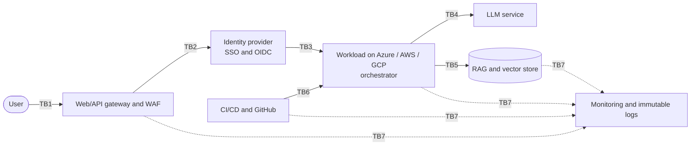

# Multi-Cloud GenAI Threat Model: Security Architecture Review

*Fictional environment. User → Web/API → Identity → Azure/AWS/GCP workload → LLM service → RAG/data layer → CI/CD → monitoring.*
*Generated by `python run.py` from `capstone/model.py`; do not edit by hand.*

## The vault analogy

> A bank vault is an asset-protection system. The wall is only one control; identity checks, dual authorization, cameras, alarms, logs and incident response matter too.

This review applies that idea to the GenAI pipeline. Each of the 27 controls sits on one element of the vault. Only the wall is network security: **4 of 27 controls**, so **85% of the design is non-network**, against the required minimum of 50%.

| Vault element | The question it answers | Technical layer | Controls |
|---|---|---|---|
| **The wall** | Can the crowd get close? Necessary, never sufficient. | Network | 4 (1 in place) |
| **Identity checks** | Who are you, really? Prove it every time. | Identity & secrets | 3 (1 in place) |
| **Dual authorization** | Can one person or one key open the vault alone? Never. | Authorization & change control | 3 (0 in place) |
| **Locked deposit boxes** | Inside the vault, does each box still have its own lock? | Data protection | 3 (1 in place) |
| **The teller window** | Is everything passed through the window inspected? | Application guardrails | 3 (0 in place) |
| **Reinforced interior** | If someone gets in, how little can they do? | Host & runtime | 2 (0 in place) |
| **Cameras** | Can we see what is happening everywhere? | Telemetry | 1 (0 in place) |
| **Alarms** | Does someone get told when behaviour looks wrong? | Detection | 2 (0 in place) |
| **The logbook** | Is there a tamper-proof record of who did what? | Audit evidence | 1 (1 in place) |
| **Incident response** | Lockdown, guards, and a plan to reopen safely. | Respond & recover | 5 (1 in place) |

## 1. Architecture and trust boundaries

Flow: User → Web/API → Identity → Azure/AWS/GCP workload → LLM service → RAG/data layer → CI/CD → monitoring.

| ID | Boundary | What crosses it | Main controls |
|---|---|---|---|
| TB1 | User → Web/API gateway | Public internet to application gateway (TLS termination) | `C01`, `C16` |
| TB2 | Web/API → Identity provider | SAML/OIDC token exchange | `C05` |
| TB3 | Identity → Azure/AWS/GCP workload | Role assignment at the compute runtime | `C06`, `C08` |
| TB4 | Workload → LLM service | Egress to an external managed API | `C03`, `C07` |
| TB5 | Workload → RAG / data layer | Private database authorization | `C02`, `C04`, `C13` |
| TB6 | CI/CD → Cloud infrastructure | Privileged deployment runner | `C09`, `C18`, `C06` |
| TB7 | All tiers → Monitoring | Log pipeline into immutable storage and alerting | `C19`, `C22` |

## 2. Critical assets

| ID | Asset | Where it lives | Impact if lost | In the vault analogy |
|---|---|---|---|---|
| A1 | Secrets and API keys | External secret vault / enveloped KMS | Critical: total platform compromise | The vault combination and keys |
| A2 | Workload OIDC identity tokens | Workload pod identity / IAM roles | High: access to downstream resources | Staff badges |
| A3 | Customer data in vector database | Vector data store (NoSQL index) | High: compliance penalties, data leak | Contents of the deposit boxes |
| A4 | Source code and CI/CD pipelines | GitHub Enterprise / build runners | High: supply-chain compromise | Vault blueprints and the construction crew |

## 3. Threat register

Likelihood and impact are scored 1-5; risk = likelihood × impact (inherent, before the proposed controls). Sorted by risk.

| ID | STRIDE | Threat | Asset | Boundary | L | I | Risk | Controls |
|---|---|---|---|---|---|---|---|---|
| T4 | Information Disclosure | Prompt injection makes the model reveal other customers' data | A3 | TB5 | 4 | 5 | 20 | C14, C13, C20 |
| T7 | Information Disclosure | LLM API key read from environment variables after an app compromise | A1 | TB4 | 4 | 4 | 16 | C07, C03, C20, C23 |
| T6 | Elevation of Privilege | Wildcard IAM on a CI/CD service account is abused to gain cloud admin | A4 | TB6 | 3 | 5 | 15 | C08, C06, C09, C21 |
| T8 | Tampering | A compromised build pipeline ships a malicious image | A4 | TB6 | 3 | 5 | 15 | C18, C09, C25 |
| T9 | Elevation of Privilege | Model output is executed by a vulnerable parser, giving code execution | A2 | TB3 | 3 | 5 | 15 | C15, C17, C24 |
| T1 | Spoofing | Stolen workload token used to impersonate the backend to the LLM or data tier | A2 | TB3 | 3 | 4 | 12 | C06, C04, C20 |
| T2 | Tampering | Poisoned documents enter the RAG store through an insecure ingestion flow | A3 | TB5 | 3 | 4 | 12 | C12, C09, C22 |
| T5 | Denial of Service | Token-flooding requests exhaust API limits and cloud budget | A1 | TB1 | 4 | 3 | 12 | C16, C01, C20 |
| T3 | Repudiation | An admin edits system prompts or LLM settings and no attributable log exists | A4 | TB7 | 3 | 3 | 9 | C22, C21, C09 |

## 4. Three multi-step attack paths

### Path A: Supply chain to cloud compromise — "The inside job"

**Chain:** CI/CD runner compromised → Cloud credential obtained → Admin-level cloud access → Production DB config modified → Customer data exfiltrated

| Edge | Attacker step | Controls that break it |
|---|---|---|
| 1 | CI/CD runner compromised → Cloud credential obtained | `C18` Ephemeral isolated build runners; signed and scanned images only `C06` Short-lived OIDC workload identity for runners and pods; no static keys |
| 2 | Cloud credential obtained → Admin-level cloud access | `C08` Least-privilege scoped roles; wildcard permissions blocked by policy-as-code in CI `C20` Anomaly alerts: LLM credential use, egress volume (DLP), privileged role use outside pipelines |
| 3 | Admin-level cloud access → Production DB config modified | `C09` Two-person approval for production, IAM and system-prompt changes `C10` Break-glass admin access: time-boxed, approved and alerted `C21` Alerts on admin, system-prompt and break-glass changes |
| 4 | Production DB config modified → Customer data exfiltrated | `C11` Encryption at rest with customer-managed keys and separate key administrators `C20` Anomaly alerts: LLM credential use, egress volume (DLP), privileged role use outside pipelines `C23` Automated token and API-key revocation playbook |

**In plain words:** Someone tampers with the construction crew's tools, borrows a master key, and walks out with the boxes. We make the key short-lived, make one key unable to do everything, and require a second signature.

**Residual risk:** A malicious change that two approvers both miss, or a determined insider with legitimate access.

### Path B: Prompt injection to code execution — "The smooth talker"

**Chain:** Public API endpoint → Malicious prompt accepted → Guardrails ignored by the LLM → Output parser executes generated script → Code execution on the container

| Edge | Attacker step | Controls that break it |
|---|---|---|
| 1 | Public API endpoint → Malicious prompt accepted | `C01` WAF and API gateway request filtering `C16` Per-client rate limits and per-key spend caps |
| 2 | Malicious prompt accepted → Guardrails ignored by the LLM | `C14` Independent input and output guardrails (separate validator) `C20` Anomaly alerts: LLM credential use, egress volume (DLP), privileged role use outside pipelines |
| 3 | Guardrails ignored by the LLM → Output parser executes generated script | `C15` Deterministic schema validation; LLM output is never executed raw |
| 4 | Output parser executes generated script → Code execution on the container | `C17` Non-root containers, read-only root filesystem, dropped capabilities `C24` Automated isolation of compromised container instances |

**In plain words:** A customer talks the teller into handing something over the counter. We inspect what goes through the window and never let anything said at the window open a door.

**Residual risk:** New injection techniques will bypass any single guardrail; the schema check (C15) must stay deterministic.

### Path C: LLM API key theft — "The pickpocket"

**Chain:** Application vulnerability exploited → Environment variables dumped → Third-party LLM API key stolen → Key used from attacker infrastructure → Corporate quota and budget depleted

| Edge | Attacker step | Controls that break it |
|---|---|---|
| 1 | Application vulnerability exploited → Environment variables dumped | `C17` Non-root containers, read-only root filesystem, dropped capabilities |
| 2 | Environment variables dumped → Third-party LLM API key stolen | `C07` Secrets pulled from a vault at runtime; none in env vars or images |
| 3 | Third-party LLM API key stolen → Key used from attacker infrastructure | `C03` Egress allow-list to approved LLM endpoints, plus provider-side IP restriction on API keys `C20` Anomaly alerts: LLM credential use, egress volume (DLP), privileged role use outside pipelines |
| 4 | Key used from attacker infrastructure → Corporate quota and budget depleted | `C16` Per-client rate limits and per-key spend caps `C23` Automated token and API-key revocation playbook |

**In plain words:** A thief lifts a badge from a coat pocket. We stop leaving badges in coat pockets, make badges work only from known doors, and cap how much any badge can spend.

**Residual risk:** A key that is stolen and used quickly from an allowed network location before an alert fires.

## 5. Prevent / detect / respond / recover control map

Status is an assumed baseline for this fictional environment. For each control: the assumption it makes, and the evidence that would prove it works.

### Prevent (18)

| ID | Control | Vault element | Status | Assumption | Evidence it works |
|---|---|---|---|---|---|
| C01 | WAF and API gateway request filtering | The wall | In place | Common attack patterns are recognisable at the edge. | Blocked-request logs; scheduled test payloads are rejected. |
| C02 | Private endpoints for vector DB, secrets manager and LLM gateway | The wall | Partial | Data-tier services never need a public address. | Cloud config scan shows no public IPs; external port scan finds nothing. |
| C03 | Egress allow-list to approved LLM endpoints, plus provider-side IP restriction on API keys | The wall | Gap | Workloads only ever talk to a short, known list of destinations. | A pod calling an unapproved host is denied and logged; a stolen key fails from other IPs. |
| C04 | mTLS between orchestrator and data tier | The wall | Partial | Both ends of an internal call can present a valid certificate. | Plain connections to the data tier are refused in a test. |
| C05 | Hardware-MFA SSO with device posture for developers and admins | Identity checks | In place | Passwords and IP addresses alone are not proof of identity. | IdP policy export; sign-in logs show no password-only logins. |
| C06 | Short-lived OIDC workload identity for runners and pods; no static keys | Identity checks | Gap | Anything long-lived will eventually be stolen. | Credential inventory finds zero static cloud keys; tokens expire within an hour. |
| C07 | Secrets pulled from a vault at runtime; none in env vars or images | Identity checks | Partial | A dumped environment must not contain anything valuable. | Secret scanning of code, images and live env finds nothing. |
| C08 | Least-privilege scoped roles; wildcard permissions blocked by policy-as-code in CI | Dual authorization | Partial | Every role can be described by the few actions its job really needs. | CI fails on any role containing a wildcard; access review shows no admin-style roles on workloads. |
| C09 | Two-person approval for production, IAM and system-prompt changes | Dual authorization | Partial | No single insider or compromised account should be able to change production alone. | Protected branch and environment settings; no change merged without a second approver. |
| C10 | Break-glass admin access: time-boxed, approved and alerted | Dual authorization | Gap | Emergencies happen, so standing admin rights are not needed. | No standing admin accounts; every break-glass use has a ticket and an alert. |
| C11 | Encryption at rest with customer-managed keys and separate key administrators | Locked deposit boxes | In place | Whoever can read the storage should not automatically hold the key. | KMS key policy review; storage admins cannot decrypt. |
| C12 | Signed, provenance-checked ingestion bundles for RAG sources | Locked deposit boxes | Gap | Retrieved documents are only as trustworthy as their source. | Unsigned or altered bundles are rejected at ingestion in a test. |
| C13 | Per-user retrieval authorization (document-level access checks at query time) | Locked deposit boxes | Partial | The model must never see more than the asking user may see. | A test user cannot retrieve another team's documents, even by prompt. |
| C14 | Independent input and output guardrails (separate validator) | The teller window | Gap | The main model can be talked out of its instructions; a second check cannot be talked out of the same way. | Red-team prompt suite; measured bypass rate tracked over time. |
| C15 | Deterministic schema validation; LLM output is never executed raw | The teller window | Gap | Model output is untrusted input to every downstream system. | Code review and tests show no path from model text to a shell, SQL or eval. |
| C16 | Per-client rate limits and per-key spend caps | The teller window | Partial | One caller should not be able to consume everyone's capacity or budget. | Load test hits the limit and is throttled; billing alert at the cap. |
| C17 | Non-root containers, read-only root filesystem, dropped capabilities | Reinforced interior | Gap | Some application bug will eventually be exploitable. | Admission policy rejects any pod that runs as root or writes to its root filesystem. |
| C18 | Ephemeral isolated build runners; signed and scanned images only | Reinforced interior | Partial | A build environment is a target, so it should hold nothing and live briefly. | Runners are destroyed after each job; unsigned images fail admission. |

### Detect (4)

| ID | Control | Vault element | Status | Assumption | Evidence it works |
|---|---|---|---|---|---|
| C19 | Central structured telemetry from app, IAM, gateway, CI/CD and LLM calls | Cameras | Partial | You cannot investigate what you never recorded. | Every tier has a log source in the SIEM; gaps are reported weekly. |
| C20 | Anomaly alerts: LLM credential use, egress volume (DLP), privileged role use outside pipelines | Alarms | Partial | Attackers behave differently from normal users and pipelines. | Simulated stolen-key use and bulk export each raise an alert within minutes. |
| C21 | Alerts on admin, system-prompt and break-glass changes | Alarms | Gap | Sensitive changes are rare enough to alert on every one. | A test change to a system prompt produces an alert naming the actor. |
| C22 | Immutable audit logs in a separate account, tied to named identities | The logbook | In place | Whoever is compromised must not be able to erase their own tracks. | WORM retention setting; log-account permissions exclude workload roles. |

### Respond (2)

| ID | Control | Vault element | Status | Assumption | Evidence it works |
|---|---|---|---|---|---|
| C23 | Automated token and API-key revocation playbook | Incident response | Partial | Speed matters more than perfection once a credential leaks. | Game-day: a leaked key is revoked in minutes, with no manual hunting. |
| C24 | Automated isolation of compromised container instances | Incident response | Gap | A suspect workload should be cut off first and examined second. | Test alert quarantines a pod and keeps forensic state. |

### Recover (3)

| ID | Control | Vault element | Status | Assumption | Evidence it works |
|---|---|---|---|---|---|
| C25 | Rebuild and redeploy from immutable IaC and signed artifacts | Incident response | Partial | A rebuilt environment is more trustworthy than a cleaned one. | Quarterly rebuild from scratch succeeds within the target time. |
| C26 | Point-in-time database recovery from isolated backups | Incident response | In place | Backups survive the same compromise as the primary only if they share credentials. | Restore test completed; backup account has separate credentials. |
| C27 | Key rotation runbook, rehearsed every quarter | Incident response | Gap | After an incident, every secret that might have been seen is replaced. | Last rehearsal date and duration recorded; zero manual-only steps. |

**Overall:** 5 in place, 12 partial, 10 gaps. Detection and response controls are the least mature part of the design, and the plan assumes they will be tested rather than merely configured. Novel LLM attack techniques will outpace any fixed rule set.

## 6. Top remediation priorities

Ranked by: sum of the risk scores of the threats a control mitigates, plus 2 per attack-path edge it breaks; partial controls count half because less work remains.

| Rank | Control | Vault element | Status | Threats mitigated | Path edges broken | Score |
|---|---|---|---|---|---|---|
| 1 | `C20` Anomaly alerts: LLM credential use, egress volume (DLP), privileged role use outside pipelines | Alarms | Partial | T1, T4, T5, T7 | 4 | 34 |
| 2 | `C06` Short-lived OIDC workload identity for runners and pods; no static keys | Identity checks | Gap | T1, T6 | 1 | 29 |
| 3 | `C09` Two-person approval for production, IAM and system-prompt changes | Dual authorization | Partial | T2, T3, T6, T8 | 1 | 26.5 |
| 4 | `C21` Alerts on admin, system-prompt and break-glass changes | Alarms | Gap | T3, T6 | 1 | 26 |
| 5 | `C14` Independent input and output guardrails (separate validator) | The teller window | Gap | T4 | 1 | 22 |

## 7. Executive summary

A bank vault is not secured by its wall. It is secured by identity checks, dual authorization, cameras, alarms, logs and a plan for when something goes wrong. We reviewed our multi-cloud GenAI service the same way.

**What we protect.** The vault keys (secrets and API keys), staff badges (workload identities), the deposit boxes (customer data behind the AI) and the blueprints (source code and build pipelines).

**What we found.** Three realistic break-ins. In the first, our build system is compromised and borrows a powerful cloud key. In the second, a carefully worded question talks the AI into running something it should not. In the third, the key to our AI provider is stolen and used to run up costs. None of them needs to beat the wall; each walks around it.

**Where we stand.** The design has 27 controls across ten vault layers. The wall is only 4 of them, so 85% of our protection does not depend on the network. Today 5 are fully in place, 12 are partial and 10 are gaps. The weakest layers are dual authorization and the teller window. Every step of all three break-ins has at least one control that stops it, and each break-in is covered by both prevention and detection or response.

**What we ask for.** Fund and complete, in this order:
1. **Anomaly alerts: LLM credential use, egress volume (DLP), privileged role use outside pipelines**.
2. **Short-lived OIDC workload identity for runners and pods; no static keys**.
3. **Two-person approval for production, IAM and system-prompt changes**.

**What remains.** Even then, a trusted insider with real approval rights, or a new way of tricking the AI, could still cause harm. The aim is to make such events hard, visible and recoverable rather than impossible. We will re-score the risks once these are done.
